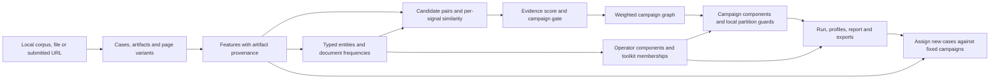

# Kolekcjoner Fejków methodology

## 0. Summary and reproduction

Kolekcjoner Fejków groups reports of scam ads and landing pages into campaigns and shows the
evidence behind each link. It extracts identifiers, file fingerprints, network traces, page
structure, images, text and public-figure references from local captures. A typed entity graph
preserves where each observation came from. A separate weighted graph links cases when
campaign-specific evidence clears a minimum strength. Shared operator traces, reusable kits and
contextual clues are reported at their own levels. New submissions can match a known campaign,
form a new group or be sent to review. This document covers feature extraction, similarity and
grouping for the NASK jury (task v2, §4).

Evaluation figures identify the development snapshots they measured.

### How to reproduce

From the repository root, use Python 3.12 and install the dependencies. The first model setup may
need network access. See the container and reference-set setup in the jury quick start.
[README](../README.md#for-the-jury-run-in-3-commands)

```bash
uv sync --extra ml --extra bge
uv run fakecollector demo --fixtures
uv run fakecollector run data/nask_backup data/nask_mentor --out runs/nask --profile full
uv run fakecollector assign "path/to/new-case" --against runs/nask
uv run fakecollector app runs/nask
```

The real-corpus commands require the two organizer-provided corpora. The assignment input can also
be a single local file or an HTTP(S) URL. The default `fast` profile skips model-backed image,
face and OCR extractors and disables BGE embeddings. It still uses base extractors and can derive
local video frames. `full` enables model-backed features where the dependencies are available.
[Data setup](DATA.md) · [CLI](../src/fakecollector/cli.py) ·
[Extraction pipeline](../src/fakecollector/pipeline.py)

```bash
uv run python scripts/evaluate.py data/nask_backup data/nask_mentor --corpus-prefix B --corpus-prefix M --gold data/fixtures/gold_labels.csv --out runs/nask/evaluation.md
uv run python scripts/evaluate.py data/fixtures/cases --corpus-prefix F --gold data/fixtures/gold_labels_fixtures.csv --out runs/demo/evaluation.md
```

The evaluator takes input folders and a gold CSV and extracts its own features with the available
dependencies. Its current CLI has no `--profile` flag and does not read the production run. The
`--profile full` option above applies to `fakecollector run`. Keep real-corpus reports and run
directories private. [Evaluation CLI](../scripts/evaluate.py) ·
[Evaluation runner](../src/fakecollector/evaluation/runner.py)



## 1. Inputs and the case abstraction

A case is one report and one clustering node. A directory with evidence files directly inside is
treated as one case. Otherwise its visible child directories are treated as cases. Ingest walks
each case recursively, including hidden files, and also handles a single file. Each `Artifact` has
a kind, a role, a byte size, a content ID (the first 16 hex digits of SHA-256), and optional page
and parent references. A case can carry several landing URLs and the earliest recorded capture
time. [Case ingest](../src/fakecollector/ingest/casefolder.py) ·
[Data contract](../src/fakecollector/core/schemas.py)

| Artifact kind | Role and interpretation |
| --- | --- |
| `har` | `network`. Recorded requests, responses and optional bodies or TLS details. Hidden HARs are supported. |
| `html` | `landing_page` or `other`. Saved DOM and page text. The redundant raw capture is classified as `other`. |
| `asset` | `landing_asset` or `other`. Sidecar resources are attached to a matching page or to a page in the same variant. |
| `image` | `screenshot` or `ad_creative`. Raster images are interpreted by role. |
| `video` | `ad_video` or `screen_recording`. Normal video containers and saved HLS input are supported. |
| `json` | `ad_library_meta`, `capture_meta`, `dns_tls` or `other`. |
| `mhtml`, `pdf` | `other`. Sources of locally decoded images or rasterized pages. |
| `url`, `text` | `other`. A submitted URL or bare text hint seeds local features in assignment. Plain text files in a folder are recorded as artifacts. |

The first nested directory can identify a capture variant. Canonical landing URLs are gathered in
capture-metadata, HAR, then saved-page order. Canonicalization lowercases scheme and host, removes
default ports, fragments and standard tracking parameters, and sorts the remaining query pairs.
Credential-like query values are masked in ingest URL metadata. The offline Public Suffix List,
including private suffixes in ingest, supplies registrable domains. URL schemas mask UUID, numeric
and long hexadecimal path segments and retain sorted parameter names. ID extraction can inspect
the original HAR or submitted URL separately.
[URL normalization](../src/fakecollector/ingest/normalize.py)

The HAR parser uses the recorded page URL when available, otherwise a qualifying document request.
Untyped HARs can fall back to a qualifying HTML response when the recorded page is not a local
file. Redirects are followed through recorded entries only. Response bodies may be plain text or
base64. Local HTML is parsed as markup and scripts may be inspected as bytes or text. Corpus URLs
are never fetched, and corpus JavaScript is never executed. Published examples use case or
campaign IDs and aggregates only. Keep the original material and derived artifacts private.
[HAR parser](../src/fakecollector/ingest/har.py) ·
[Data rules](DATA.md#2-safety-rules-real-partly-live-scam-material)

Identical artifact content is kept once within a case. Within each corpus, a nonempty artifact ID
set contained in an earlier unique report's set is marked with `duplicate_of`. The marked report
remains a node and still contributes to case counts and document frequencies. Distinct saved pages
at the same URL remain available as variants. A comparison of their visible-text shingles can set
`cloaking_suspected` (§8).

## 2. Feature extraction

An observation has a registry name, a string value or vector, an artifact ID, a locator, and
optional extractor confidence. Each row below names the producing module and all output feature
names. The registry assigns the tiers and weights in §4. Graph scoring uses those weights and the
observed similarity. Extractor confidence remains available as provenance and does not multiply
the graph contribution. [Registry](../src/fakecollector/core/registry.py) ·
[Signal scoring](../src/fakecollector/graph/signals.py)

| Family and producer | Features and tier | Observation, value and gates |
| --- | --- | --- |
| IDs · `har_ids.py` | `ids.kit_landing`, `ids.ad_param`, `ids.click_key` (campaign), `ids.kit_tenant`, `ids.fb_pixel`, `ids.gtag` (operator) | Regex and query parsing of HAR URLs and bodies, saved HTML and text-like assets. A landing deployment or tracked ad can persist across domains. Tenant and tracker accounts can span stories and are subject to their frequency limits (§3). IDs may be absent or rotated. |
| IDs / text · `ad_library.py` | `ids.ad_library` (campaign), `ids.advertiser_page`, `ad.advertiser` (operator), `text.ocr` (input) | Reads saved yt-dlp metadata, extracts the ad archive ID and advertiser identifiers, and passes title or description to text analysis. An advertiser may run several ads. The local JSON limit is 20 MiB. |
| IDs / infra / text · assignment input | `url.domain` and parsed campaign IDs (campaign), parsed tenant/tracker IDs (operator), `url.schema` (toolkit), `text.raw` (input) | A bare URL gives local domain, schema and recognized ID features. A bare hint gives raw text. A URL alone offers limited corroboration. |
| Asset · `asset.py` | `asset.sha256` (campaign) | Exact SHA-256 of saved landing assets and recorded HAR response bodies of at least 512 bytes. Byte-for-byte reuse survives domain changes. Re-encoding breaks the match, and frequent files or one widely shared file are suppressed. |
| Infra / IDs · `infra.py` | `infra.host_3p`, `infra.endpoint`, `infra.redirect_hop`, `url.outlink_domain` (operator), `url.schema` (toolkit), `url.domain` (campaign) | Parses HAR traffic and saved HTML resource and link attributes, forms, meta refresh and simple script redirect literals. Endpoints capture POSTs and collector-like paths, with first-party hosts masked. Shared platforms and generic endpoints can mislead. Only recorded or literal redirects are observable. |
| Infra · `infra_meta.py` | `infra.favicon_mmh3`, `infra.ip`, `infra.cert_san` (operator), `infra.server_stack`, `infra.cert_issuer` (context) | Saved favicon bytes or HAR bodies give signed MurmurHash3 over MIME base64. HAR headers give server stack with major-version normalization. HAR and saved DNS/TLS metadata supply non-CDN IPs, issuers and SAN names. Shared hosting and common issuers have low specificity. |
| Infra · opt-in enrichment library | `infra.ns`, `infra.cert_san` (operator), `infra.asn`, `infra.registrar`, `infra.cert_issuer` (context), `infra.registered` (info) | DNS, routing, registration and certificate metadata can help with dead sites. Availability and sharing vary by provider. These library functions are separate from the current production extraction path (§12). |
| Template · `template.py` | `html.dom_minhash`, `html.css_minhash`, `kit.path_sig`, `kit.sdk` (toolkit) | Sketches HTML layout and CSS class vocabulary. First-party HAR paths are masked for UUIDs, long hex runs and digits. An SDK-like path with JavaScript MIME emits a path signature in `kit.sdk`. Shared chrome or a common kit can span campaigns. DOM and CSS can be promoted under §4. |
| Image · `image_hash.py` | `img.phash`, `img.pdq` (campaign) | Whole images and creative regions give 64-bit DCT pHash and optional 256-bit PDQ. Resizing and recompression can preserve the match. Shared graphics and interface chrome can cause false matches. The size and flat-graphic gates below apply. |
| Image / person · `image_embed.py` | `img.siglip` (campaign), `brand.impersonated`, `brand.logo` (context) | SigLIP2 gives 768-dimensional unit vectors for whole images and eligible creative regions. Headers and tiles add views for logo recognition. A logo in a screenshot's header band (or filling it) is `brand.impersonated`; elsewhere only when the page title or site-name meta names the same brand. Otherwise a whole landing logo image is `brand.logo` (possible "as seen on" trust badge) and a tile match is dropped. Flat landing graphics can supply brand context only. Similar-looking layout can raise cosine for unrelated cases. |
| Text · `html_page.py` | `html.title`, `text.raw` (inputs) | Extracts title and visible page text from landing HTML, discarding head and non-visible elements after reading the title. Cookie notices and other boilerplate can survive. Saved text reads are bounded to 8 MiB. |
| Text / IDs · `ocr.py` | `text.ocr` (input), `ad.advertiser` (operator), `ocr.domain` (context) | EasyOCR reads Polish and English from screenshots, creatives and keyframes. A sponsored-label heuristic reads the advertiser, and domain parsing repairs common OCR punctuation errors. The image is resized to at most 1,280 px on the long side, requires an 8 px short side after resizing, and drops detections below 0.20. Normalized text needs at least 3 characters. Landing assets are excluded. |
| Text · `text.py` | `text.minhash`, `text.headline_tpl`, `text.bge` (campaign), `text.topic` (context), `text.lang` (info) | Derives features per source from page title/body, OCR, supplied hint or ASR. Text sources need at least four word tokens. Headline rules mask dates, numbers and likely names, using a title or OCR fallback when no title qualifies. Optional BGE-M3 embeds up to 512 tokens. Keyword topics and language heuristics are coarse. |
| Person · `face.py` | `person.public_figure` (context) | Detects faces and compares cosine against public-figure centroids and individual references, taking the larger score. Defaults require a 120 px image short side, detection score ≥ 0.60, face short side ≥ 40 px and match cosine ≥ 0.40. The file limit is 60 MiB. Unmatched embeddings are discarded. |
| Person · `brand.py` | `brand.impersonated` (context) | A SigLIP prompt and reference logo must agree on their top brand. The prompt probability times `clip((best logo cosine for the brand − mean brand cosine) / 0.10)` must reach 0.60. With no logo references the zero-shot fallback requires ≥ 0.95. Small or lookalike logos can be missed or confused. |
| Person · `brand_rules.py` | `brand.impersonated` (context) | HTML title suffix and site identity metadata identify a brand; logo-marked image attributes give only `brand.logo`. Its own known registrable domains are excluded. A reused portal skin can span unrelated stories. |
| Video · `video.py` | Derived screenshots and `text.asr` (input) | FFmpeg samples at 1 fps, scales to a maximum 960 px side and selects scene cuts above 0.30 plus a time grid, up to 40 frames per video. Local HLS only. faster-whisper transcribes Polish speech deterministically (temperature 0, beam 5, no conditioning on previous text). ASR is on by default on any hardware (`FAKECOLLECTOR_ASR=0` disables it; the setting is logged), with `turbo` on GPU and `small` on CPU unless `FAKECOLLECTOR_ASR_MODEL` pins one. |
| Derived media · `derived.py` | Derived images and their image, brand, person, OCR and ID features, plus optional `text.asr` | Extracts keyframes, MHTML image parts and PDF rasters. MHTML is limited to 200 distinct accepted images, each ≤ 30 MiB and ≥ 120 px per side. PDFium renders up to five pages at 150 DPI with a 4,000 px side cap and a 120 px minimum side. Production stores the derived artifacts with parent references. The evaluator's derived extractor re-attributes vision features to the source with frame, part or page locators. |
| Image helper · `regions.py` | Crop coordinates for the hash and embedding extractors | Estimates the frame background, then retains dense, textured components, up to three crops. Regions have sides ≥ 64 px and cover 6–85% of the source image. Whole-image features remain available when crops are unavailable. |
| Image experiment · `local_match.py` | Geometric match and inlier count in the robustness experiment | SIFT or ORB ratio-test matching followed by RANSAC homography checks for a shared image region. Reused stock can also verify. The production graph does not consume this result. |
| Shared helpers · `_media.py`, `_text.py`, `__init__.py` | Raster role checks, bounded text decoding and package declaration | The helpers support the extractors above. Text reads replace undecodable bytes, and the package declaration emits no features. |

The perceptual hash and SigLIP extractors require a readable raster with both sides at least 120
px. They exclude vector images and icons and share a 60,000,000-pixel decode guard. Their
flat-graphic test applies to landing assets. It downsamples grayscale to 256 × 256 and marks a
graphic when more than two thirds of pixels have a summed local gradient below 2. Such assets can
still yield exact SHA-256 matches and logo context. Hashing reduces the longest side to at most
512 px before computing descriptors.
[Image hashes and gates](../src/fakecollector/extractors/image_hash.py) ·
[SigLIP extraction](../src/fakecollector/extractors/image_embed.py) ·
[Creative regions](../src/fakecollector/extractors/regions.py)

## 3. Entity graph and evidence tiers

Each retained key or set value creates an entity keyed by `<type>:<value>`. A
`Case -[HAS]-> Entity` observation stores the case, entity and artifact IDs. The matching feature
row supplies the locator. Typical nodes include `KitLanding`, `KitTenant`, `Tracker`, `Asset`,
`Domain`, `Host`, `Endpoint`, `Narrative`, `Brand` and `Person`. The registry table below shows
all declared types. The graph resolves redirect hops to `RedirectHop` and outlinks to
`OutlinkDomain`. Page variants are recorded on artifacts. MinHash, embeddings and perceptual
hashes enter the similarity stage directly and create no entity nodes in the current builder.
[Entity construction](../src/fakecollector/graph/entities.py)

| Tier | Examples | What sharing supports |
| --- | --- | --- |
| Campaign | Landing deployment, file collection, headline, near-duplicate creative | A same-campaign hypothesis if at least one individual signal meets the gate. |
| Operator | Tenant, pixel, advertiser page, collector, non-CDN address | A shared account or infrastructure trail, potentially spanning multiple campaigns. An operator group is an investigative lead about shared resources. |
| Toolkit | SDK-like path, URL schema, path signatures, DOM/CSS | A common builder or template. Only sufficiently similar DOM/CSS can be promoted to campaign evidence, subject to the gate. |
| Context | Public figure, brand, topic, ASN, issuer | Corroboration and analyst triage. Common topics and infrastructure can recur independently. |

Document frequency counts distinct cases, including cases that supply no features in the
denominator. Repeated observations in one case add provenance without adding frequency.
Campaign-tier keys, such as a landing ID, ad-library ID or domain, are stopped only by a supplied
or enabled default stop-list. A large campaign should keep its strongest evidence even when it
accounts for much of the batch. Document frequency is still recorded and used in rarity weighting.
The frequency cap applies to entities in the other tiers and to campaign set members such as
shared library files. If multiple registry features feed a capped entity, the smallest fraction
applies.

```text
df(v) = number of distinct cases observing entity v
N = number of distinct cases in the analysis
stop_by_frequency(v) = df(v) > max(max_df_min, max_df(v) × N)
max_df_min = 3
```

The bundled stop-list matches common platform hosts by suffix and Cloudflare and Fastly edge
ranges by CIDR. Default graph checks apply to IPs and the registry's Host, Domain and Endpoint
types. Capture extraction also filters CDN IPs. Common asset hashes are handled by frequency.
Stopped entities retain their provenance and flag in the graph and are excluded from scoring and
operator/toolkit membership. Image hashes use their own extraction and bucket guards (§4).
[Stop-list](../src/fakecollector/graph/stoplist.toml) ·
[Stop-list implementation](../src/fakecollector/graph/stoplist.py)

Typed observations allow analysts to pivot from a case through a shared asset, account or host and
see the supporting artifacts. This also gives the scorer a place to control common infrastructure
before projecting to case-to-case links. Graph computation runs in-process. The run directory uses
Parquet tables and NumPy vectors, and Neo4j consumes an optional export for Cypher exploration.
[ADR 0003](decisions/0003-python-first-delivery.md) ·
[ADR 0004](decisions/0004-graph-technology-and-model.md) ·
[Run store](../src/fakecollector/store.py)

## 4. Candidate generation and similarity

Batch analysis takes the union of pairs proposed by shared active entities, MinHash
locality-sensitive hashing (LSH), perceptual hash bands and mutual vector neighbours. This limits
which pairs need the full feature comparison. Exact pair scoring compares features with the same
registry name and preserves the strongest cross-artifact match where appropriate. Assignment
supplies all new-to-base pairs explicitly (§7). [Blocking](../src/fakecollector/graph/blocking.py)
· [Signals](../src/fakecollector/graph/signals.py)

### Shared keys and sets

A shared key is weighted by inverse document frequency with a floor for campaign keys. The floor
protects a distinctive landing or narrative key when several reports in the same corpus share it.
The stop-list is checked before scoring, and the document-frequency cap still applies to keys
outside the campaign tier.

```text
rarity(v) = 1                                      if N ≤ 2
          = min(1, ln(N / df(v)) / ln(N / 2))       otherwise
strength(v) = max(0.75, rarity(v))                  for campaign keys
            = rarity(v)                            for other keys
evidence weight(v) = min(tier_cap, w × strength(v))
```

For sets, take the IDF-weighted fraction of the smaller active set found in the other set.
Containment tolerates a partial capture of a larger page. A single common SDK or library asset is
weak evidence. With the default `set_min_shared = 2`, a campaign set with only one overlapping
value passes this check only when that value occurs in the two cases alone.

```text
idf(v) = ln((N + 1) / df(v))
W(S) = sum(idf(v) for v in S)
containment(A, B) = W(A ∩ B) / min(W(A), W(B))
```

### MinHash

Text is normalized with Unicode NFKC, lowercasing and whitespace cleanup while retaining Polish
diacritics. Text sketches use unique five-word shingles, with the whole sequence used for a
qualifying four-word source. DOM sketches use unique four-token shingles over the document-order
`depth:tag` sequence and require at least eight distinct shingles. CSS sketches use the nonempty
lowercased class vocabulary. The extractors use 128 permutations and seed 0. LSH generates
candidates per feature name with a configured threshold of 0.40. This is a retrieval parameter and
the scorer recomputes signature similarity for candidate pairs.

```text
estimated Jaccard = number of equal corresponding signature entries / 128
case-pair similarity = maximum estimate across valid artifact pairs
```

DOM or CSS with estimated Jaccard ≥ 0.85 is promoted from toolkit to campaign evidence for that
pair. Lesser structural matches remain toolkit evidence when they contribute.
[Text normalization](../src/fakecollector/core/text.py) ·
[Template extraction](../src/fakecollector/extractors/template.py)

### Fuzzy headlines

A screenshot rarely reproduces a known headline character for character: OCR drops diacritics
and quotes, merges a colon into a word ("strzelałw:") or adds the site name. After the usual
`{PERSON}`/`{NUM}`/`{DATE}` masking, `text.headline_fuzzy` compares the content words of two
headline templates (placeholders and punctuation cut, diacritics folded, at least four words) with
a token-set ratio. Identical templates are left to the exact key. At or above the threshold the
match is campaign evidence weighted like a softened exact key: 0.60 × (0.75 + 0.25 × the position
of the ratio between the threshold and 1.0). Near-copies are also blocking candidates. The
threshold is label-free: on the two-corpus base run, each headline is compared with all headlines
of the *other* campaigns the run itself formed (no gold labels), and the q99.5 of these per-headline
maxima (0.636) is used, rounded to 0.64. The per-headline maximum is the relevant null because an
upload is compared with every base headline; the plain pairwise q99.5 is 0.514.
`scripts/calibrate_headline_fuzzy.py RUN_DIR` prints both distributions for a run.

### Dense vectors

Vectors are grouped by feature and dimension and normalized for cosine comparison. Each vector
searches the top 20 cross-case vectors in its group. A pair of vectors that ranks each other in
this list proposes the case pair. The implementation computes exact dot products in blocks of 256
rows. The case-pair score for a vector feature uses the best same-dimension cosine across
artifacts, including pairs proposed by another signal. BGE-M3 uses anchors 0.75/0.90. SigLIP2 uses
0.90/0.97. The higher image lower anchor limits matches on similar stock images and page layouts.
[Vector blocking and scoring](../src/fakecollector/graph/vectors.py) ·
[Graph defaults](../src/fakecollector/graph/config.py)

### Perceptual image hashes

The scorer minimizes Hamming distance over comparable whole images and crops for each hash type.
When both cases have PDQ observations, PDQ takes precedence over pHash. This choice follows the
higher observed PDQ precision after image gating. [Vision signal evaluation](results-vision.md)

```text
H(a, b) = popcount(a XOR b)
s = 1 − min(H(a, b)) / bit_width
D = floor(bit_width × (1 − lo))
```

Blocking splits each hash into `D + 1` disjoint bands. At distance at most `D`, at least one band
matches exactly. Shared bands propose candidates, then a distance check enforces `H ≤ D`. Buckets
with more than `max(50, 0.05 × N)` distinct cases are skipped. The current lower anchors give
`D = 8` for 64-bit pHash and `D = 38` for 256-bit PDQ. These are runtime blocking limits. The PDQ
≤ 31 convention in the vision evaluation was an experiment setting.
[Blocking implementation](../src/fakecollector/graph/blocking.py) ·
[Vision robustness experiments](robustness-vision.md)

### Scoring registry and anchors

For an anchored set, sketch, cosine or image hash, `lo` is the zero-strength anchor and `hi` is
the saturation anchor. Sets without anchors use containment directly. The scorer emits evidence
only for positive contributions.

```text
clip(x) = max(0, min(1, x))
strength = clip((s − lo) / (hi − lo))
evidence weight = min(tier_cap, w × strength)
```

The table gives every registry row. Entity types are the declared types, before the graph's redirect
and outlink mapping (§3). The two vector anchor pairs come from `EdgeConfig`. An em dash marks an
inapplicable frequency cap or an unanchored feature.
[Feature registry](../src/fakecollector/core/registry.py) ·
[Graph defaults](../src/fakecollector/graph/config.py)

| Feature | Family | Tier | Declared entity | Kind | Weight | Applied df fraction | Effective lo / hi |
| --- | --- | --- | --- | --- | ---: | ---: | --- |
| `ids.kit_landing` | ids | campaign | `KitLanding` | key | 0.97 | — | — |
| `ids.kit_tenant` | ids | operator | `KitTenant` | key | 0.40 | 0.50 | — |
| `ids.fb_pixel` | ids | operator | `Tracker` | key | 0.40 | 1.00 | — |
| `ids.gtag` | ids | operator | `Tracker` | key | 0.40 | 0.30 | — |
| `ids.ad_param` | ids | campaign | `AdParam` | key | 0.80 | — | — |
| `ids.click_key` | ids | campaign | `ClickKey` | key | 0.80 | — | — |
| `asset.sha256` | asset | campaign | `Asset` | set | 0.90 | 0.30 | 0.15 / 0.60 |
| `text.raw` | text | campaign | — | info | 0.00 | — | — |
| `html.title` | text | campaign | — | info | 0.00 | — | — |
| `text.minhash` | text | campaign | — | minhash | 0.85 | — | 0.30 / 0.70 |
| `text.headline_tpl` | text | campaign | `Narrative` | key | 0.60 | — | — |
| `text.headline_fuzzy` | text | campaign | — | fuzzy (of `text.headline_tpl`) | 0.60 | — | 0.64 / 1.00 (config) |
| `text.bge` | text | campaign | — | vector | 0.50 | — | 0.75 / 0.90 (config) |
| `text.topic` | text | context | `Topic` | key | 0.10 | 1.00 | — |
| `infra.host_3p` | infra | operator | `Host` | set | 0.40 | 0.30 | — |
| `infra.endpoint` | infra | operator | `Endpoint` | key | 0.40 | 0.30 | — |
| `infra.redirect_hop` | infra | operator | `Host` | set | 0.40 | 0.30 | — |
| `url.schema` | infra | toolkit | `UrlSchema` | key | 0.25 | 0.50 | — |
| `url.outlink_domain` | infra | operator | `Domain` | set | 0.40 | 0.30 | — |
| `html.dom_minhash` | template | toolkit | — | minhash | 0.50 | — | 0.50 / 0.90 |
| `html.css_minhash` | template | toolkit | — | minhash | 0.50 | — | 0.50 / 0.90 |
| `kit.path_sig` | template | toolkit | `PathSignature` | set | 0.25 | 0.50 | — |
| `kit.sdk` | template | toolkit | `Toolkit` | key | 0.25 | 1.00 | — |
| `infra.favicon_mmh3` | infra | operator | `Favicon` | key | 0.40 | 0.30 | — |
| `infra.server_stack` | infra | context | `ServerStack` | key | 0.25 | 1.00 | — |
| `infra.ip` | infra | operator | `IP` | key | 0.25 | 0.30 | — |
| `infra.cert_issuer` | infra | context | `CertIssuer` | key | 0.10 | 1.00 | — |
| `infra.cert_san` | infra | operator | `CertSan` | set | 0.40 | 0.30 | — |
| `img.phash` | image | campaign | — | hash | 0.80 | — | 0.86 / 0.97 |
| `img.pdq` | image | campaign | — | hash | 0.80 | — | 0.85 / 0.95 |
| `img.siglip` | image | campaign | — | vector | 0.45 | — | 0.90 / 0.97 (config) |
| `brand.impersonated` | person | context | `Brand` | key | 0.35 | 0.50 | — |
| `brand.logo` | person | context | `BrandLogo` | key | 0.10 | 0.50 | — |
| `person.public_figure` | person | context | `Person` | key | 0.35 | 0.50 | — |
| `text.ocr` | text | campaign | — | info | 0.00 | — | — |
| `text.asr` | text | campaign | — | info | 0.00 | — | — |
| `ad.advertiser` | ids | operator | `Advertiser` | key | 0.40 | 0.30 | — |
| `ids.ad_library` | ids | campaign | `AdLibraryId` | key | 0.97 | — | — |
| `ids.advertiser_page` | ids | operator | `AdvertiserPage` | key | 0.40 | 0.30 | — |
| `url.domain` | ids | campaign | `Domain` | key | 0.90 | — | — |
| `ocr.domain` | ids | context | `OcrDomain` | key | 0.20 | 0.30 | — |
| `infra.ns` | infra | operator | `NameServers` | key | 0.40 | 0.30 | — |
| `infra.asn` | infra | context | `ASN` | key | 0.20 | 0.50 | — |
| `infra.registrar` | infra | context | `Registrar` | key | 0.10 | 1.00 | — |
| `infra.registered` | infra | context | — | info | 0.00 | — | — |
| `text.lang` | text | context | — | info | 0.00 | — | — |

## 5. Evidence fusion and campaign gate

Fusion pools the strongest campaign-tier evidence per family and the strongest evidence in each of
the three corroborating tiers. These slots prevent shared observations such as multiple pixels or
many similar images from accumulating within one slot. The per-family maxima on an edge describe
matches across tiers. Fusion reads the tiered evidence slots.

| Slot | Maximum contribution |
| --- | ---: |
| Each campaign family | 1.00 |
| Operator across all families | 0.40 |
| Toolkit across all families | 0.25 |
| Context across all families | 0.35 |

```text
slot_weight = max(evidence weights in the slot)
evidence score = clip(1 − product(1 − slot_weight for each populated slot))
```

Noisy-OR gives an evidence score on the unit interval. Read it together with the **number of
independent campaign families** supporting the edge, counted as distinct families with positive
campaign-tier evidence. The count describes the breadth of support. Families can share a source
artifact, so their contributions can be correlated. High evidence scores can saturate and the
scale has no statistical calibration.

A confirmed link requires one campaign-tier evidence item with weight ≥ 0.50. If both cases have
non-informational text features and the text family produces no positive evidence, template
evidence can contribute to the score but cannot satisfy the gate. A promoted template is eligible
when comparable text is absent. SigLIP2 contributes at most 0.45, so a similar layout combined
with a shared public figure cannot establish a campaign link on its own.

In batch, every retained pair must first pass the campaign gate. Edges scoring at least
`tau = 0.60` enter campaign grouping. The 0.15 batch review band also retains scores in
`[tau − 0.15, tau)` when at most two families are comparable. Assignment scores all comparable
pairs before applying its own rules (§7).
[Fusion and edge retention](../src/fakecollector/graph/fusion.py)

**A and B, shared operator traces.** The gold annotation records shared tenant and tracker or
collector traces across the two campaigns and a common fake-portal appearance with different
stories. Consider a cross-campaign pair with such active operator evidence and an otherwise
qualifying CSS match, where comparable text contributes zero. The CSS item cannot open the
campaign gate. Operator and toolkit evidence cannot open it either. Shared active operator
entities still connect cases through union-find. This example explains the decision rule without
requiring raw identifiers.
[Corpus observations and gold labels](DATA.md#4-what-the-data-shows-measured) ·
[Separation regression test](../tests/graph/test_end_to_end.py)

**A across two corpora, shared landing deployment.** One kit landing ID spans five domains in
campaign A. To illustrate the score, take an active landing key at the rarity floor and a
qualifying asset set with containment 0.375. The key contributes `0.97 × 0.75 = 0.7275` and opens
the gate. The asset set contributes `0.90 × (0.375 − 0.15) / (0.60 − 0.15) = 0.45`. These two
independent campaign families, IDs and assets, give `1 − (1 − 0.7275) × (1 − 0.45) = 0.850125`,
above the clustering threshold. The containment value is illustrative.
[Corpus observations](DATA.md#4-what-the-data-shows-measured)

### Where the numbers come from

Structural priors encode analyst knowledge. An exact kit landing or ad-library identifier is
near-conclusive evidence (weight 0.97 before rarity weighting). Operator traces such as pixels,
tenants and collectors are capped at 0.40 because they can identify shared control across
campaigns. Context such as a person, brand or ASN is capped at 0.35 because it describes the
subject or setting. A campaign link requires at least one qualifying campaign-level signal.

The starting similarity anchors are measured values from DATA.md §4.6 and the associated asset
observations, the vision benchmark experiments, and the audit's pair distributions. The
label-free calibration PR in progress (`scripts/calibrate.py`, `docs/calibration.md`) specifies
a report of anchors from null-pair quantiles and synthetically perturbed positives. The defaults
use the 99.5th percentile for the lower anchor and the 10th percentile for the upper anchor,
with shrinkage toward the starting values. An update is applied only where it is more
conservative. The table gives the branch defaults.
[DATA.md §4](DATA.md#4-what-the-data-shows-measured) · [Vision benchmark](benchmark-vision.md) ·
[Vision signal measurements](results-vision.md) · [Vision robustness](robustness-vision.md)

The decision threshold τ = 0.60 lies in a measured gap. In audit 02, the highest-scoring
unrelated pair reached 0.50 and the lowest accepted variant reached 0.72 on ungated scores.
Grouping was insensitive to τ over 0.60–0.90 on those cases. The gap and range are in-sample
measurements.

The inventory gives the defaults with all three P0 changes. Sensitivity comes from audit 02
§§2–3, which replayed cached features from 25 gold cases on snapshot `7d0c2f9`. These sweeps
precede P0. Rows with new decision logic distinguish baseline evidence from sensitivity that
has yet to be measured.
[Registry](../src/fakecollector/core/registry.py) · [Graph defaults](../src/fakecollector/graph/config.py)

| Parameter | Value | Kind | Provenance | Sensitivity in audit 02 |
| --- | --- | --- | --- | --- |
| Kit landing and ad-library ID weights | 0.97 each | Structural prior | Exact deployment or ad identity | No effect within ±25–50% in the individual weight sweep. |
| Ad parameter and click key weights | 0.80 each | Structural prior | Exact advertising identifiers | No separate result reported for these two IDs. |
| Asset set and domain weights | 0.90 each | Structural prior | Exact file or domain reuse | No effect within ±25–50%. |
| Text MinHash, headline template, BGE weights | 0.85, 0.60, 0.50 | Structural prior | Lexical, masked headline and semantic matches | No effect within ±25–50%. |
| pHash and PDQ weights | 0.80 each | Structural prior | Near-duplicate image evidence | No effect within ±25–50% for PDQ. No separate pHash result reported. |
| SigLIP weight | 0.45 | Structural prior | Similar layouts can recur across campaigns | ×1.5 gave precision 0.83 and cross-corpus FAR 0.14. Scaling all weights by ×1.5 gave the same failure. |
| Operator weights | 0.40, except IP at 0.25 | Structural prior | Shared operator traces and lower specificity of IP | No effect within ±25–50% for the operator weight group. No separate IP result reported. |
| DOM and CSS weights | 0.50 each before the tier cap | Structural prior | Template reuse can qualify as campaign evidence | No separate weight result reported. |
| URL schema, kit path and SDK weights | 0.25 each | Structural prior | Shared tools can serve distinct campaigns | No effect within ±25–50% for the toolkit weight group. |
| Context weights | Person and brand 0.35, server stack 0.25, ASN 0.20, topic, issuer and registrar 0.10 | Structural prior | Contextual corroboration | No effect within ±25–50% for person and brand. Other context weights were not itemized. |
| Informational weights | 0.00 | Structural prior | Registry inputs and metadata | No sweep reported. |
| Text MinHash and DOM/CSS anchors (lo / hi) | 0.30 / 0.70 and 0.50 / 0.90 | Measured anchor | DATA.md §4.6 similarity measurements | No effect within ±25–50%. |
| Asset containment anchors (lo / hi) | 0.15 / 0.60 | Measured anchor | DATA.md §4 asset measurements and audit 02 null distribution | Halving hi reduced held-out variant accuracy from 0.80 to 0.60. |
| BGE cosine anchors (lo / hi) | 0.75 / 0.90 | Measured anchor | Text similarity observations and audit 02 null maximum of 0.69 | No effect within ±25–50%. |
| pHash and PDQ anchors (lo / hi) | 0.86 / 0.97 and 0.85 / 0.95 | Measured anchor | Vision benchmark experiments and audit 02 image measurements | No effect within ±25–50% for PDQ. No separate pHash result reported. |
| SigLIP cosine anchors (lo / hi) | 0.90 / 0.97 | Measured anchor | Vision benchmark experiments and audit 02 image measurements | Lowering lo to 0.875 merged the disputed D pair. |
| Tier caps | Campaign 1.00, operator 0.40, toolkit 0.25, context 0.35 | Structural prior | Maximum strength per slot | No effect within ±25–50% for the corroborating caps. |
| Document-frequency cap and stop-list | Stop when df > max(3, fraction × N) for capped entities (`max_df_min = 3`). Effective `max_df` fractions are 0.30, 0.50 and 1.00 (§4). Campaign keys are stop-listed only. Default stop-list enabled. | Structural prior | Common infrastructure and library suppression, with the campaign key exception from PR #37 | ×1.5 reduced held-out variant accuracy from 0.80 to 0.60. In the old rule, HAR-only recall fell from 0.84 to 0.12 as one campaign grew from 24% to 33% of the batch. |
| Campaign key floor | `campaign_key_floor = 0.75` | Structural prior | Preserve a shared key's weight as campaign prevalence grows | No effect within ±25–50%. |
| Campaign set overlap | `set_min_shared = 2`. A lone shared value qualifies only at df ≤ 2. | Structural prior | Suppress isolated common files | No effect within ±25–50% for minimum overlap. The df exception was not swept. |
| Template promotion and text gate | Jaccard ≥ `template_campaign_threshold = 0.85`. A promoted template can open the gate when text is unavailable or emits evidence. | Decision threshold | Distinguish campaign template matches from reused chrome | No effect within ±25–50% for promotion. The text gate was not swept. |
| Campaign evidence gate | `min_campaign_evidence = 0.50` on a single item | Decision threshold | Audit 02 semantic false positive failure, PR #40 | 0.15–0.225 merged the disputed D pair. Raising the baseline gate to 0.375–0.60 had no effect. |
| Batch edge threshold τ | `tau = 0.60` | Decision threshold | Audit 02 measured gap, 0.50–0.72 | No effect over 0.60–0.90. At ≤ 0.45, precision fell to 0.90 with one false merge. |
| Batch review band | `review_band = 0.15` below τ, at most two comparable families, campaign gate required | Decision threshold | Prior for sparse comparisons | No effect within ±25–50% on the audited assignment path. The family limit was not swept. |
| Assignment threshold and margin | `tau_assign = 0.60`, `assign_margin = 0.10` | Decision threshold | Prior for acceptance and separation from the runner-up | No effect within ±25–50% under the old assignment rules. Sensitivity after P0 is unmeasured. |
| Strong link | `strong_link = 0.90` | Decision threshold | Audit 02 sparse-input failure, PR #40 | Post-P0 override and rival check were not swept. |
| Assignment review thresholds | `review_min_score = 0.50`, `review_min_campaign_evidence = 0.15` | Decision threshold | Audit 02 in-sample review experiment, PR #40 | Post-P0 rule was not swept. |
| Cross-modal assignment | `crossmodal_bge = 0.70`, `crossmodal_siglip = 0.90`, `crossmodal_margin = 0.10` | Decision threshold (**in-sample**) | Read off the eight held-out variant cases of the hidden-test simulation (audit 03): own-page OCR text reached BGE 0.69–0.95 against ≤ 0.60 for other campaigns; own creatives reached SigLIP 0.89–0.98 | Not swept. Must be validated on the other fold before being treated as calibrated. |
| Partial re-submission duplicate | Every file of the input is in one base case (artifact hash, or PDQ distance 0 for images); all holders in one campaign | Structural prior | Re-submitted screenshot, creative, video or PDF of a known case. One shared file out of many is not enough: in leave-one-campaign-out, a single shared landing asset (loader script, UI mock-up, page asset) made 7/25 new cases score-1.0 duplicates of another campaign | Not swept; no threshold. |
| Cross-modal corroboration | Second family = a person, brand or advertiser key carried by exactly one base campaign (the target), or the other vector leading the same campaign by ≥ `crossmodal_margin` | Structural prior (specificity) | Campaign frequency 1 is the label-free IDF floor: a key in two campaigns cannot pick one. `text.topic` never corroborates (a few topics cover every scam; in LOCO it was the only second family behind a SigLIP false accept) | No new threshold. |
| Operator consistency | Two or more known operators trigger a batch partition. Different operator IDs send a would-be non-duplicate acceptance to review. | Structural prior | One operator per campaign in ADR 0004, PRs #39 and #40 | Post-P0 rules were not swept. |
| Size and cohesion guard | Size > max(50, 0.05 × N) and mean internal strong-edge score < 0.50 | Decision threshold | Prior for large, weak components | Not swept. Default τ puts internal edge scores above the cohesion cutoff. |
| Local partition resolution and seed | 1.0 for `operator_split`, 2.0 for `giant_split` (2 × resolution), seed 0 | Structural prior | Prior inherited from Leiden/Louvain settings, PR #39 scopes the partition | Under global Leiden, 0.50–1.25 had no effect and 1.50 split a six-case clique (F1 0.27). Local partitioning was not swept. |
| MinHash LSH cutoff and signature | `lsh_threshold = 0.40`, 128 permutations, seed 0 | Structural prior | Candidate retrieval settings | No effect within ±25–50% for the cutoff. Signature settings were not itemized. |
| Mutual vector kNN | `knn_k = 20` cross-case vectors per query | Structural prior | Candidate retrieval setting | No effect within ±25–50%. |
| Perceptual-hash candidate limits | D = floor(bits × (1 − lo)), 8 for pHash and 38 for PDQ. Skip buckets above max(50, 0.05 × N) cases. | Derived (D), structural prior (bucket guard) | Hash-band construction and common-image suppression | D follows the anchors. Bucket guard was not swept. |
| Assignment aggregation | Maximum comparable pair score, comparable mean for ties. Best minus runner-up maximum for margin. | Derived | Pair evidence scores, PR #40 | Audit 01 and audit 02 §3 identify single-link misses under the old averaging rule. |
| Assignment explanation | Up to ten evidence items from the top three pairs into the best campaign | Structural prior | Bound the displayed evidence list | Display limit only. |

### Why not learn the weights

The labelled set has five multi-case campaigns and 19 positive pairs, 15 from one campaign.
In audit 02 §§3.7 and 7, regularized logistic regression evaluated by leave-one-campaign-out
scored PR-AUC 0.96–0.97 against 1.00 for ungated prior-based fusion. The experiment supports
keeping the transparent weights.

### How stable it is

In audit 02 §§2 and 7, perturbing each of 42 parameters or groups by ±25–50% left 33 with no
effect. Joint Monte-Carlo jitter at ±25% kept strict campaign F1 between 0.905 and 1.00
(median 0.973). Four of 40 draws produced a false merge traced to one image-similarity pair.
At ±50%, the median and minimum were again 0.973 and 0.905, with false merges in 10 of 40 draws.
Nonzero FAR appeared in 3% of ±25% draws under LOCO and 7% under cross-corpus evaluation.
At ±50%, those rates were 12% and 17%. The table locates the sensitive settings in the
pre-P0 method.

## 6. Grouping and common-traits profiles

**Campaigns.** Start with connected components over campaign-gated edges with evidence scores
≥ τ. Isolates are singleton campaigns. Cohesion is the mean score of the internal strong edges,
with 1.0 for a group without such edges. Partitioning runs only within a component when either
guard triggers, in this order.

1. **Size and cohesion.** If size exceeds `max(50, 0.05 × N)` and cohesion is below 0.50,
   partition once at twice the configured resolution and flag the resulting groups `giant_split`.
   With the default τ of 0.60, every internal strong edge already scores above 0.50.
2. **Operator consistency.** If the component includes cases from two or more known operator
   groups, partition once at the configured resolution and flag the results `operator_split`.
   A capture combining several stories can supply the bridge between operator groups.

Both guards use seeded, weighted Leiden with the RB configuration partition by default
(resolution 1.0, seed 0), with weighted NetworkX Louvain when selected or when Leiden imports
are unavailable. Restricting the partitioner to the component keeps unrelated edges out of its
objective. Components preserve chains of genuine variants, including when different pairs
share different artifacts. Transitivity also means one false strong edge can join otherwise
distinct stories, which makes the campaign gate and operator check important.

A campaign ID is `C-` plus the first eight SHA-256 hex digits of its lexicographically smallest
member ID. This stabilizes IDs for a repeated partition of the same case IDs.
[Clustering](../src/fakecollector/graph/cluster.py) ·
[Analysis orchestration](../src/fakecollector/graph/analyze.py)

The giant-cluster guard reruns community detection once at twice the resolution if group size
exceeds `max(50, 0.05 × N)` and cohesion is below 0.50. The resulting groups receive
`giant_split`. Under the default `tau = 0.60`, a mean of strong edges cannot fall below 0.50, so
the guard requires a different configuration to trigger.

**Operators and toolkits.** Union-find joins cases transitively across every active operator
entity shared by at least two cases. The operator ID is `O-` plus the same eight-digit hash rule
on the component's smallest member. A campaign inherits a unique known operator among its cases.
If several known groups remain after partitioning, the operator is left unset and the campaign
gets `mixed_operator`. Active toolkit entities yield overlapping memberships and a campaign
lists the union across its cases. A toolkit entity can be reported from a single case.
[Clustering and memberships](../src/fakecollector/graph/cluster.py)

**Labels and profiles.** A campaign label uses its most frequent public figure and masked headline
when both are available. Otherwise the label uses up to three class-based TF-IDF terms from raw,
OCR and ASR text, a headline fallback, or the initial label from strongest evidence or the case
ID. Profiles show which active entities recur and which key-valued traits rotate. A constant trait
needs member coverage ≥ 0.80 and ranks by tier, lift and evidential weight, with up to ten entries
per type by default. A rotating trait needs at least two observed cases and two values, no value
reaching 0.80 coverage, and at least half as many distinct values as observed cases. The written
explanation lists up to four values.

```text
coverage = members observing the trait / campaign size
constant lift = coverage / (entity df / N)
rotating lift = coverage of the type / corpus prevalence of the type
label term score = term count within campaign × ln(1 + mean class length / corpus term count)
```

[Profile logic](../src/fakecollector/graph/profile.py) ·
[Campaign labelling](../src/fakecollector/graph/cluster.py)

## 7. Open-set assignment

A new batch inherits the saved run's extraction profile and seed. Assignment uses the combined
base and batch to recompute entity frequencies and stop status. It compares each new case to each
base case with the same pair scorer. All pairs with at least one comparable family reach
assignment, including scores below τ, scores of zero and pairs that fail the campaign gate.

The duplicate index matches an exact multiset of non-informational features (name, value and
vector) containing a campaign-tier feature, or an exact nonempty set of artifact IDs observed in
the feature rows. Ties use the first base case ID lexicographically. A duplicate of a base campaign
member gives that campaign an evidence score of 1. This rule is separate from ingest
`duplicate_of` (§1).

```text
campaign evidence score = strongest pair score to a comparable member (1 for a duplicate)
margin = best campaign score − runner-up campaign score (runner-up defaults to 0)
```

A single strong match can support assignment even when the remaining members lack comparable
artifacts. Absent modalities contribute no evidence and incur no penalty. On tied maxima,
prefer the duplicate campaign, then the higher mean over comparable members, then the
lexicographically first campaign ID. The mean affects only ranking ties. Assignment reports
comparable families across all scored pairs and up to ten evidence items from the three
highest-scoring pairs into the best campaign.

The margin passes at ≥ 0.10, including float equality via
`isclose(margin, 0.10, abs_tol=1e-12)`. A competing link is a runner-up whose strongest pair
passes the campaign gate while the margin falls short.

| Decision | Rule |
| --- | --- |
| `existing` | Exact duplicate of a base campaign member. Otherwise the best pair must pass the campaign gate, and its evidence score must be ≥ `tau_assign = 0.60` with a passing margin, or ≥ `strong_link = 0.90` with no competing link that also reaches 0.90. The operator check below still applies. |
| `review` | A non-duplicate would be accepted but its inferred operator differs from the best campaign's known operator. For other cases that fall short of acceptance, review requires a best pair with evidence score ≥ `review_min_score = 0.50`, any campaign-tier item on that pair with weight ≥ `review_min_campaign_evidence = 0.15`, or a competing link. |
| `new` | Remaining cases. Operator and toolkit links can still accompany the decision. |

**Cross-modal rule for sparse inputs.** A screenshot, ad creative, video or PDF often shares no
key with the landing page; its only bridge is a dense vector compared across modalities (OCR or
ASR text against page text with BGE, a creative against landing images with SigLIP). Each such
signal alone stays below τ and the 0.5 gate, so two weak agreeing signals used to be dropped. In
the assignment path only (batch clustering is unchanged): `existing` when the best raw cosine to a
campaign reaches 0.70 (BGE) or 0.90 (SigLIP), leads the next campaign by ≥ 0.10, **and** a second,
independent and discriminative family agrees with the same campaign. That family is either the
other vector, which must itself lead the same campaign by ≥ 0.10, or a person, impersonated brand or
advertiser key that is active (not stopped) and carried by no base campaign other than the target.
Context that scams share does not count: `text.topic` never does, and trust badges (`brand.logo`)
and OCR domains are not candidates. Otherwise the vector lead alone gives `review` with the
matched artifacts, never `existing`.
For inputs with at most three comparable families the campaign score is the larger of the best
edge and the top-k mean. These thresholds were read off the same eight variant cases used to
measure the failure (audit 03) and are **in-sample**; they must be validated on the other fold.

A duplicate is an exact feature or artifact-set match, or a partial re-submission: every file of
the input is already in one base case, by artifact hash or, for images, by PDQ distance 0, and all
base cases holding those files belong to one campaign. A single shared file among otherwise new
files is not a duplicate: template assets, kit loaders and stock mock-ups recur across unrelated
campaigns, so they stay ordinary, df-capped edge evidence.

Review gives an analyst the best candidate and its evidence when a match is weak, ambiguous or
could come from a multi-story capture. The operator check requires both a known campaign operator
and an inferred operator for the input. Active shared operator entities can identify one known
base operator. When those traces match base cases without known operator groups, assignment may
report the combined component ID. Conflicting known groups leave the input's operator unset.

The normal command writes assignment reports without adding cases to the base run. With
`assign --commit`, accepted cases extend their base campaigns and the base campaign IDs stay
fixed. `cluster_new` uses the same combined frequency context and groups only the new decisions
by connected components with the size/cohesion guard. It attaches operator IDs after clustering,
so the in-clustering `operator_split` check applies to batch analysis. Review cases are persisted
as separate singletons.
Operator, toolkit and campaign results remain distinct fields.
[Assignment](../src/fakecollector/graph/assign.py) ·
[Persistence](../src/fakecollector/pipeline.py)

## 8. Incomplete and messy input

| Condition | Runtime treatment |
| --- | --- |
| Missing family | `comparable` is the intersection of families with a registered non-info feature on each side. Missing families contribute no evidence and incur no similarity penalty. A comparable family can still produce no match. |
| Dead page or capture error | A recorded landing HTTP status ≥ 400 flags `capture_error`. Affected variants are skipped for the cloaking comparison. Other available artifacts can still yield evidence, and the flag does not globally remove the error capture from extraction. |
| Misfiled HAR | A HAR with a different registrable site can move to a unique matching case within the corpus. With ambiguous or missing destination, ingest keeps it and flags a mismatch. |
| Screenshot-only or video-only | Ingest flags the case. Extraction can still use image regions, identities read from OCR and derived text or, for video, keyframes and optional ASR. The amount of recoverable campaign evidence varies (§9). |
| Corrupt or oversized file | File access and extractor errors are handled per file or extractor. Ingest's default artifact limit is 2,048 MiB. Missing model dependencies can leave a family unavailable. A case with no usable features can remain an isolate. |
| Non-UTF-8 name | On filesystems that expose undecodable filename bytes through surrogate escapes, display strings escape those bytes while the original path stays available for local reads. Page titles come from the saved HTML. |
| Cloaking variants | Ingest compares distinct readable landing pages grouped by canonical URL within a case. Exact visible-text five-shingle Jaccard below 0.50 flags `cloaking_suspected`, with no decision on empty shingle sets. The flag is a lead for review. |

The available artifacts govern what the evidence score can support. A thin submission can link
through a single strong pair, reach review with weaker signals, or start a new campaign.
[Case ingestion](../src/fakecollector/ingest/casefolder.py) ·
[Comparable families](../src/fakecollector/graph/signals.py) ·
[Assignment rules](../src/fakecollector/graph/assign.py)

## 9. Evaluation

The development gold CSV contains team annotations for 25 cases, 15 backup and 10 mentor. Strict
evaluation keeps disputed D together, giving 19 positive campaign pairs among 300. Lenient
evaluation splits D into singletons, giving 18 positive pairs. Operator labels are evaluated
separately, with unlabelled operators treated as singletons.
[Data guide and gold labels](DATA.md#5-gold-labels-combined-25-cases) ·
[Gold CSV](../data/fixtures/gold_labels.csv)

Pairwise precision measures the correct fraction of predicted same-group pairs. Pairwise recall
measures the recovered fraction of gold pairs. F1 is their harmonic mean. B-cubed averages each
case's cluster overlap precision and recall, counting the case itself, and takes the harmonic mean
of those averages. Adjusted Rand Index (ARI) uses same-group pair counts adjusted for chance given
the group sizes. [Metric implementation](../src/fakecollector/evaluation/metrics.py)

| Open-set split | Protocol |
| --- | --- |
| Held-out variant | In each multi-case gold campaign, hold out the first case by ID and rebuild the base from the rest. |
| Leave-one-campaign-out (LOCO) | Hold out each gold campaign in turn, including singletons. Its cases should all be classified as new. |
| Cross-corpus | Build the base from one labelled corpus and assign the other as a batch. The reported direction is backup → mentor. |

The base is clustered afresh for each split. A known case is correct when it is automatically
assigned to a predicted group containing all of its gold peers in the base. An unseen case is
correct when classified as new. Reviews count against automatic accuracy and are reported
separately. FAR is the share of truly new cases accepted as existing. FRR is the share of truly
known cases called new. The evaluator also reports best-campaign score distributions.
[Evaluation protocol](../src/fakecollector/evaluation/protocol.py)

Calibration uses held-out-variant known scores and LOCO new scores. If the scores separate and the
midpoint of maximum new and minimum known clears the floor and maximum new score, use that
midpoint. Otherwise use the next representable float above the first descending new score whose
rank fraction exceeds 0.05, or zero if there is no such rank. Clamp to the 0.50 floor and 1.00
ceiling. The suggested margin stays 0.10. This is score-only calibration on the development
splits. The evaluation decision table uses the graph defaults.

### Results

The real-corpus results below come from `scripts/evaluate.py` on `main` @ 4f8dfb1 (22.11), GPU,
every extractor available, combined 25 cases. The pre-fix baseline row is kept for comparison.
The fixture results are from the synthetic fixture run. A dash marks an unreported metric for
that row. Full aggregate tables: [results.md](results.md).

| Run and target | Pairwise P | Pairwise R | Pairwise F1 | B-cubed F1 | ARI |
| --- | ---: | ---: | ---: | ---: | ---: |
| Real, strict campaign, before vision precision fixes | 0.692 | 0.947 | 0.800 | 0.917 | 0.784 |
| Real, strict campaign, current | 1.000 | 0.947 | 0.973 | 0.980 | 0.971 |
| Real, strict operator, current | 1.000 | 1.000 | 1.000 | 1.000 | 1.000 |
| Fixtures, strict campaign and operator, each | 1.000 | 1.000 | 1.000 | 1.000 | 1.000 |

| Open-set split | Real accuracy | Real FAR | Real review rate | Fixture accuracy | Fixture FAR |
| --- | ---: | ---: | ---: | ---: | ---: |
| Held-out variant | 100% (5/5, FRR 0%) | — | 0% | 50% | — |
| LOCO | 92% | 0% (0/25) | 8% | 50% | 33.3% |
| Cross-corpus backup → mentor | 90% | 0% | 10% | — | — |

The strict real splits suggest `tau_assign ≈ 0.64` (separated-score midpoint); the decision rule
uses the graph default 0.60. Under lenient labels LOCO FAR is 8% and cross-corpus FAR 12.5%, both
from the single disputed pair in campaign D. The team reported 1 min 42 s for the full production
pipeline on both real corpora on GPU; the evaluation run above took 3 min 44 s including all
splits. Single-file sparse inputs against a base without the variant (team simulation, 21.11):
MHTML 8/8, HAR 7/8, PDF 7/8, degraded screenshots 15/17.
[Fixture and real results](results.md) ·
[Earlier vision baseline](robustness-vision.md#real-corpus-campaign-clustering-scriptsevaluatepy-both-corpora-strict-labels)

Family ablation rebuilds the graph after removing one registry family at a time. Each
single-family removal retained real-corpus campaign F1 of 0.973, showing redundancy on these
captures. Fixture F1 dropped to 0.500 when removing IDs or text and stayed 1.000 for each other
removal. Input-type ablation keeps feature rows by source artifact role and retains every labelled
case in the denominator. It tests screenshot/creative, HAR, HTML plus landing assets, and
video/recording in isolation. Campaign pairwise recall was 0.947 for HTML-only, 0.842 for
HAR-only, **0.053 for screenshot-only and 0 for video-only**, with no false pair in any of them. This is the
main observed coverage gap for grouping corpus cases.
[Input ablation implementation](../src/fakecollector/evaluation/protocol.py) ·
[Fixture ablation](results.md#ablation)

The earlier image-signal study found 18 true and zero false positives for gated PDQ ≤ 31, versus
18 true and one false positive for pHash ≤ 8. In the image retrieval experiment, creative regions
raised feed-image SigLIP recall@1 from 0.36 to 0.68. Geometric reranking reached 0.81. These are
image-level results. The separate extraction benchmark measured 68.7 s cold GPU, 1.1 s warm GPU
and 490.4 s cold CPU (ASR off) inside the vision pipeline. [Vision signals](results-vision.md) ·
[Vision robustness](robustness-vision.md) · [Vision benchmark](benchmark-vision.md)

A false bridge can pull unrelated stories into one campaign and contaminate the resulting
indicators. The gate, caps and review rules prioritize precision where shared templates, operators
or stock images could otherwise create that bridge.

## 10. Explainability and analyst outputs

Each retained link carries Polish evidence with the feature, tier, score contribution and source
artifacts or locators. Distinct campaign-tier families in these items give the number of
independent campaign families behind the link (§5). The self-contained HTML report shows campaign
membership and evidence text. The report builder also writes `campaigns.json`. Assignment has
CSV and HTML outputs. The graphical demonstrator is the Next.js web UI (Polish) on top of a
read-only FastAPI: overview, campaign pages with "why linked" evidence, case pages with extracted
features, a network graph of reports, campaigns and shared traces, and an "Analizuj" page that
assigns an uploaded file, screenshot, URL or product name against the run (saved by default, with
an undo).
[Report](../src/fakecollector/report/build.py) ·
[Web UI](../web/README.md) · [API](../src/fakecollector/api/server.py)

| Export format | Analyst use |
| --- | --- |
| Neo4j | Node and relationship CSVs and `import.cypher` with constraints, `MERGE` statements and pivot queries. |
| GEXF and GraphML | Case and entity graph with HAS and SIMILAR links for analysts' graph tools. |
| IOC CSV | Campaign-level indicators with case support, tier, raw and defanged values, and warning-list candidate flags. |
| Dataset | Per-case JSON Lines, Parquet tables and schema. Includes feature provenance, profiles, group assignments and neighbours. |
| JSON | Serialized analysis graph for local processing. |

Organizational handover of the enriched dataset is subject to the NASK data rules. Campaign
observations are described separately in [PATTERNS.md](PATTERNS.md).

## 11. Limitations and next steps

The results cover 25 development cases, including the disputed D label. Audit 02 observed zero
false accepts in 25 LOCO trials. Treating those trials as independent, the one-sided 95% upper
bound on FAR is about 11% (11.3% before rounding). Demonstrating a 5% bound needs more independent
trials. Input reductions reuse the same cases and add no independent trials.

Several visual and asset anchors sit near the sample maximum of 281 negative pairs. For a signal
with zero false fires across 281 independent negatives, the one-sided 95% upper bound is ≤ 1.1%
per signal. SigLIP fired on four of the audit negatives at its lower anchor. The weights, caps
and decision thresholds remain priors until calibrated, and measured anchors remain specific to
the development distributions. [Data measurements](DATA.md#4-what-the-data-shows-measured) ·
[Vision signal measurements](results-vision.md)

Screenshot-only and video-only recall is the first priority (0.053 and 0, respectively, in
§9). When only visual evidence is available from a screenshot or video, automatic links require
a near-duplicate image match or the cross-modal rule of §7 (a clear vector lead plus a second,
different family). Weaker visual matches that meet the review criteria go to review.

Some variants cannot be linked offline at all. When a sibling ad changes both its creative and its
wording, its cross-modal similarity to the campaign (in the hidden-test simulation, BGE around
0.55 and SigLIP 0.55–0.79) is the same as to unrelated cases; only the landing page it leads to
would connect it. Passively, the system answers `new` or, for a bare URL on an unseen domain,
"za mało danych" rather than guessing.
OCR and ASR can supply separate campaign evidence when usable. Evaluate creative region retrieval
and geometric confirmation as a candidate stage, then test the result in end-to-end grouping and
open-set decisions. Validate thresholds on a larger independent set with duplicate leakage
controlled across folds. Shared operator resources warrant analyst verification before attributing
control.

Leiden dependencies are GPL and the buffalo_l model weights are restricted to non-commercial
research. Louvain can be selected from Python via `EdgeConfig`. A hosted demonstration should use
synthetic fixtures, and organizers' uploads and derived data belong in a private local run. CPU
inference uses the installed model dependencies and references. ASR is on by default on CPU
and GPU (`FAKECOLLECTOR_ASR=0` disables it). Local Windows verification exposed FFmpeg filter-path and filename-byte test failures.
The jury setup documents a Linux container. [README credits](../README.md#credits--licenses) ·
[Jury container setup](../README.md#for-the-jury-run-in-3-commands)

## 12. Sources, access and usage limits

The optional enrichment library requires `ALLOW_ENRICH=true`. Its fixed public metadata endpoints
receive registrable domains or eligible IPs, and the CERT feed is downloaded by fixed URL.
Successful bodies are cached by a hash of the request URL under `~/.cache/fakecollector/enrich`
by default, with no expiry in the helper. Failed requests are remembered for the process.
The default HTTP timeout is 5 s and the code has
no request pacing loop. CERT also keeps a successful list in memory and distinguishes
unavailability from a domain that did not match. The current `run` and `assign` pipelines do not
call the enrichment helpers automatically.
[Enrichment implementation](../src/fakecollector/enrich/__init__.py) ·
[HTTP helper](../src/fakecollector/enrich/http.py) · [Settings](../src/fakecollector/config.py)

| Source | Contribution | Access, terms and limits |
| --- | --- | --- |
| Cloudflare DNS-over-HTTPS | Sorted NS set as one operator feature. Also carries the Cymru TXT queries. | Public and keyless. Resolver privacy policy applies. The API reference lists no numeric request quota. [DoH API](https://developers.cloudflare.com/1.1.1.1/encryption/dns-over-https/make-api-requests/) · [Privacy policy](https://developers.cloudflare.com/1.1.1.1/privacy/public-dns-resolver/) |
| Team Cymru IP-to-ASN | BGP origin ASN for captured non-CDN IPv4, with holder description in provenance. | Free keyless community service. The provider gives volume guidance for DNS and bulk access, with no published numeric DNS quota in its guide. [Usage guide](https://www.team-cymru.com/ip-asn-mapping) |
| RDAP via RDAP.org | Registration month and registrar from the registry response. | Keyless bootstrap. The redirector documents 10 requests per 10 seconds. Registry-specific terms and limits also apply. [RDAP.org](https://about.rdap.org/) |
| Sectigo crt.sh | Certificate issuer CNs and SANs outside the queried registrable domain. The code requests unexpired results and reads up to 200 returned entries. | Public and keyless. The operator reported 5 HTTPS requests per IP per minute in 2023. Treat that as historical guidance, since throttling and availability vary. [Operator rate-limit note](https://groups.google.com/g/crtsh/c/QXQFoy331pE) |
| CERT Polska Warning List | Checks a domain or its parents down to the registrable domain, for analyst triage. | Public and keyless. The repository credits CERT Polska and records free use with attribution. CERT recommends a five-minute refresh for blocking integrations. This project caches the feed for analytical use. [CERT Polska usage guidance](https://cert.pl/lista-ostrzezen/) · [Project credits](../README.md#credits--licenses) |
| Meta Ad Library metadata | Parses locally supplied yt-dlp metadata for ad archive ID, advertiser and ad copy. | Offline parsing needs no key and makes zero requests. Upstream collection is subject to Meta terms and access limits. The official API requires separate access setup. The yt-dlp source is released under the Unlicense. [Meta collection terms](https://www.facebook.com/legal/automated_data_collection_terms) · [Ad Library API](https://www.facebook.com/ads/library/api/) · [yt-dlp license](https://github.com/yt-dlp/yt-dlp/blob/master/LICENSE) |
| Public Suffix List and published CDN ranges | Offline domain boundaries and Cloudflare/Fastly edge filtering. | Bundled snapshots, with no runtime requests or keys. PSL is MPL-2.0. Provider range lists are credited. [Project credits](../README.md#credits--licenses) |
| Wikimedia Commons reference photos and logos | Public-figure and logo reference vectors. | Per-file licenses apply. References are prepared separately from analysis, with no live lookup during matching. [Reference photo credits](../refs/faces.csv) · [Logo credits](../refs/logos.csv) |

Method-defining components include datasketch for MinHash, ImageHash and PDQ for perceptual
fingerprints, SigLIP2 and BGE-M3 for dense similarity, EasyOCR and faster-whisper for text from
media, and InsightFace for public-figure matching. Leiden and NetworkX provide the graph
partitioning options. [Full model and library credits](../README.md#credits--licenses)
